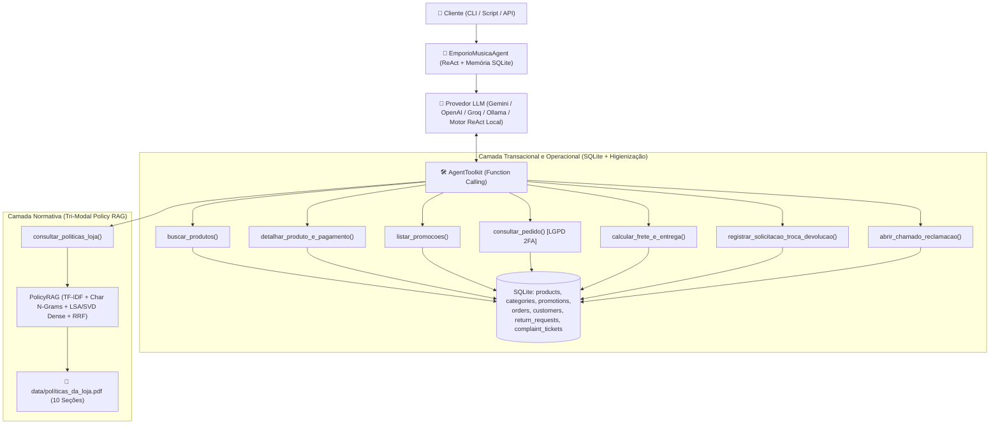

# 🎸 Empório da Música — Agente Inteligente de Atendimento ao Cliente

> **Desafio Técnico — AI Engineer (Artefact 2026)**
> Protótipo de agente conversacional em Python para automação e suporte ao atendimento da **Empório da Música** (Campo Grande/MS), combinando **Function Calling (ReAct)** sobre banco relacional higienizado (**SQLite**) e **RAG Híbrido** sobre o manual interno de políticas (**PDF**).

---

## 📋 Sumário

1. [Visão Geral e Arquitetura](#-visão-geral-e-arquitetura)
2. [Como Executar o Projeto](#-como-executar-o-projeto)
3. [Justificativa das Decisões Técnicas](#-justificativa-das-decisões-técnicas)
4. [Tratamento de Dados, Anomalias e Suposições Documentadas](#-tratamento-de-dados-anomalias-e-suposições-documentadas)
5. [Exemplos de Interação (`examples/`)](#-exemplos-de-interação-examples)
6. [Limitações Conhecidas e Evoluções Futuras](#-limitações-conhecidas-e-evoluções-futuras)
7. [Workflow e Uso de Assistentes de IA](#-workflow-e-uso-de-assistentes-de-ia)

---

## 🏗 Visão Geral e Arquitetura

O atendimento da **Empório da Música** exige duas naturezas distintas de recuperação de informação:
1. **Consultas Exatas e Transacionais (`data/*.csv`)**: Preços, quantidade em estoque, especificações técnicas, validade de promoções (`is_active`), cálculo de descontos/parcelamento e rastreamento de pedidos não toleram alucinação ou aproximação vetorial.
2. **Consultas Normativas e Procedimentais (`data/políticas_da_loja.pdf`)**: Regras de troca, Direito de Arrependimento (CDC), garantia, prazos de frete, horário de funcionamento e diretrizes de escopo demandam busca semântica e lexical sobre texto não-estruturado.

Para resolver ambos os problemas com alta confiabilidade, foi implementada uma **Arquitetura Híbrida de Agente (Tool-Calling / ReAct + SQL Relacional + Policy RAG)**:



### Estrutura do Repositório

```text
├── data/
│   ├── desafio_tecnico_ai_eng - categories.csv
│   ├── desafio_tecnico_ai_eng - customers.csv
│   ├── desafio_tecnico_ai_eng - order_items.csv
│   ├── desafio_tecnico_ai_eng - orders.csv
│   ├── desafio_tecnico_ai_eng - products.csv
│   ├── desafio_tecnico_ai_eng - promotions.csv
│   └── políticas_da_loja.pdf
├── examples/                                      # 5 conversas completas (.md) geradas pelo agente
│   ├── 01_catalogo_violoes_ate_1000.md
│   ├── 02_preco_promocoes_e_pagamento_takamine.md
│   ├── 03_devolucao_arrependimento_e_rastreio_pedidos.md
│   ├── 04_informacoes_gerais_frete_e_horario.md
│   └── 05_fora_de_escopo_acessorios_e_off_topic.md
├── scripts/
│   └── generate_examples.py                       # Script reprodutível que gera os exemplos em examples/
├── src/
│   ├── __init__.py
│   ├── config.py                                  # Configurações via .env e detecção de provedor LLM
│   ├── database.py                                # Ingestão, limpeza de dados e banco SQLite em memória
│   ├── policy_rag.py                              # Parser de PDF (pdfplumber) e Retriever Híbrido TF-IDF
│   ├── tools.py                                   # 6 ferramentas estruturadas + calculadora de pagamento/CDC
│   ├── memory.py                                  # Persistência de histórico e tool traces em SQLite
│   ├── prompts.py                                 # System Prompt e diretrizes de Persona (Seção 7 do Manual)
│   ├── agent.py                                   # Loop ReAct / Function Calling multi-provedor + fallback local
│   └── cli.py                                     # Interface CLI interativa com inspeção de tools em tempo real
├── tests/
│   └── test_agent_and_tools.py                    # Suíte de testes automatizados (pytest)
├── .env.example
├── main.py                                        # Ponto de entrada principal
├── requirements.txt
└── README.md
```

---

## 🚀 Como Executar o Projeto

### 1. Pré-requisitos e Instalação

Certifique-se de ter o **Python 3.10+** instalado. Clone o repositório e instale as dependências:

```bash
git clone https://github.com/GaabrielCH/desafio-ai-engineer-artefact-emporio-musica.git
cd desafio-ai-engineer-artefact-emporio-musica

python -m venv .venv
# No Windows (PowerShell):
.\.venv\Scripts\Activate.ps1
# No Linux/macOS:
# source .venv/bin/activate

pip install -r requirements.txt
```

### 2. Configuração de Ambiente e Provedor de Modelo (`.env`)

Copie o arquivo `.env.example` para `.env`:

```bash
cp .env.example .env
```

O projeto possui uma arquitetura **agnóstica de provedor com auto-detecção (`LLM_PROVIDER=auto`)**:
- **Com chave de API (Gemini, OpenAI, Groq ou Ollama)**: Basta preencher uma das variáveis (`GEMINI_API_KEY`, `OPENAI_API_KEY`, `GROQ_API_KEY` ou `OPENAI_BASE_URL` para Ollama local) no `.env`. O agente utilizará **Function Calling nativo** do modelo escolhido.
- **Execução imediata Zero-Config (`LLM_PROVIDER=local` ou sem chaves no `.env`)**: Caso nenhuma chave de API seja informada, o projeto executa automaticamente seu **Motor ReAct Determinístico Local**, que roteia intenções, aciona exatamente as mesmas ferramentas SQL/RAG (`AgentToolkit`), registra os traces de chamadas e sintetiza respostas fiéis à persona da loja. Isso garante que a avaliação funcione imediatamente após o `git clone`, mesmo sem chaves externas.

### 3. Comandos de Execução

- **Iniciar o Chat Interativo na CLI**:
  ```bash
  python main.py
  ```
  *(Dentro do chat, utilize `/tools` para exibir/ocultar chamadas de ferramentas, `/historico` para ver a sessão persistida no SQLite, `/limpar` para reiniciar a memória, `/demo` para rodar os cenários de demonstração ou `/sair` para encerrar).*

- **Executar a Demonstração Automática dos 5 Cenários no Terminal**:
  ```bash
  python main.py --demo
  ```

- **Enviar uma Pergunta Única via Linha de Comando**:
  ```bash
  python main.py -m "Quais opções de violões disponíveis custando até R$1000?"
  ```

- **Executar a Suíte de Testes Automatizados (`pytest`)**:
  ```bash
  python -m pytest -v
  ```

- **Regerar os 5 Arquivos de Exemplo em `examples/`**:
  ```bash
  python scripts/generate_examples.py
  ```

---

## 🧠 Justificativa das Decisões Técnicas

| Decisão | Escolha Adotada | Justificativa Técnica |
| :--- | :--- | :--- |
| **Abordagem do Agente** | **Híbrida: Function Calling (ReAct) + SQL Relacional + RAG** | Dados tabulares (`products.csv`, `orders.csv`, `promotions.csv`) exigem filtros numéricos exatos (`preco <= 1000`, `stock_quantity > 0`, `is_active == 1`) e *joins* relacionais (`orders -> order_items -> products`), onde um RAG puramente vetorial falharia ou alucinaria valores. Por outro lado, o manual em PDF contém diretrizes textuais que são melhor recuperadas via RAG semântico/lexical por seção. |
| **Arquitetura de Retrieval (Políticas PDF)** | **Chunking Estrutural por Seção + TF-IDF Híbrido (Word `1..2` + Char `3..5` N-Grams) + Boost de Domínio** | O PDF `políticas_da_loja.pdf` possui 8 páginas organizadas em 10 seções numeradas coesas. Segmentar pelas seções reais do documento (evitando quebras artificiais no meio de tabelas ou regras de parcelamento) preserva 100% do contexto de cada política. A combinação de TF-IDF de palavras e n-gramas de caracteres com `scikit-learn` oferece tolerância a erros de digitação/acentuação e latência sub-milissegundo sem depender de API externa de embeddings. |
| **Ferramentas de Negócio (Guardrails Determinísticos)** | **6 Tools Especializadas com Regras de Negócio Embutidas** | Regras matemáticas críticas do manual — como o **parcelamento escalonado** (1–3x mín. R$ 50; 4–6x mín. R$ 80; 7–12x mín. R$ 100), a **não-cumulatividade do desconto de 5% no PIX com promoções ativas** (Seção 6.2) e o **cálculo de dias corridos para Direito de Arrependimento (7 dias) e Defeito (30/90 dias)** — são calculadas deterministicamente em Python dentro das tools e entregues prontas ao LLM, eliminando erros aritméticos do modelo. |
| **Provedor e Modelo** | **Multi-Provedor (`gemini-2.5-flash` / `gpt-4o-mini` / `llama-3.3-70b`) + Fallback ReAct Local** | Permite testar tanto com LLMs comerciais rápidos e econômicos em Function Calling quanto rodar 100% offline de maneira determinística e reprodutível. |
| **Persistência do Histórico** | **SQLite (`data/chat_history.db`)** | Permite retomar sessões anteriores (`--session <id>`), resolver correferências em múltiplos turnos (ex.: *"E como fica o parcelamento dele?"* ou *"Meu pedido é o #7"*) e auditar todas as chamadas de ferramentas (`tool_calls_json`) geradas em cada turno. |
| **Estratégia de Prompting** | **Persona Guiada por Políticas + Grounding Estrito** | O `SYSTEM_PROMPT` incorpora a identidade da Empório da Música (tom acolhedor, informal mas profissional — Seção 7.1), proíbe confirmação de estoque/preço sem consulta às tools e instrui o redirecionamento educado para pedidos de acessórios ou perguntas fora de escopo. |

---

## 🔍 Tratamento de Dados, Anomalias e Suposições Documentadas

Durante a análise exploratória dos arquivos em `data/*.csv` e `data/políticas_da_loja.pdf`, foram identificadas inconsistências e casos de borda intencionais no dataset. Todos foram tratados no código (`src/database.py`, `src/policy_rag.py` e `src/tools.py`) e estão documentados abaixo:

1. **Produtos Ativos com Estoque Zero (`out_of_stock`)**:
   - O violão **Giannini GF-3D Dreadnought Sunburst (`product_id=96`)** possui `status='active'`, porém `stock_quantity=0`.
   - **Decisão**: Classificado com disponibilidade efetiva `out_of_stock`. Seguindo a **Seção 7.3 do Manual**, ele é excluído de buscas por itens disponíveis e, quando consultado diretamente, o agente informa a indisponibilidade temporária e sugere automaticamente 3 violões equivalentes com estoque ativo.
2. **Produtos Descontinuados com Estoque Residual (`discontinued`)**:
   - O contrabaixo **Ibanez Bass 2X (`product_id=136`)** possui `stock_quantity=13`, mas `status='discontinued'` (assim como o violão 7 cordas **Shelby SN-7C, `product_id=113`**, com `status='discontinued'` e `stock=0`).
   - **Decisão**: O campo `status='discontinued'` tem precedência sobre `stock_quantity`. Conforme a **Seção 7.3**, o agente informa que o modelo foi descontinuado do catálogo ativo e recomenda modelos equivalentes ativos.
3. **Produto em Pré-Lançamento (`coming_soon`) referenciado em Pedidos**:
   - O ukulele **Kala KA-ABP-CTG Barítono Cedar (`product_id=130`)** está com `status='coming_soon'`, mas aparece nos pedidos `#3` e `#14`.
   - **Decisão**: No catálogo de vendas o item é sinalizado como pré-lançamento (`coming_soon`), enquanto a consulta de pedidos preserva normalmente o histórico dos pedidos `#3` e `#14`.
4. **Promoções Expiradas vs. Ativas (`promotions.csv`) e Não-Cumulatividade com PIX**:
   - Das 25 linhas em `promotions.csv`, apenas **4 estão ativas (`is_active=1`)**: `Kalani KAL-700T` (10%), `Ohana CK-20` (20%), `Crafter HT-100` (18%) e `Taylor 110e` (8%). As outras 21 (incluindo `Takamine GD20` com 12% e campanhas de Black Friday/Páscoa/Semana do Músico) têm `is_active=0`.
   - **Decisão**: Apenas promoções com `is_active=1` alteram o preço vigente. Quando um cliente pergunta sobre um produto com promoção inativa (`is_active=0`), a tool retorna o histórico expirado para que o agente informe com transparência que a campanha encerrou (**Seção 7.3**). Além disso, para os 4 itens com promoção ativa, o desconto de 5% do PIX **não é aplicado cumulativamente** (**Seção 6.2**).
5. **Divergência entre Nome e Descrição em Produtos Sintéticos (`product_id` 135 a 144)**:
   - Alguns itens de baixo, bateria e teclado possuem marca/modelo divergente entre a coluna `name` e a coluna `description` (ex.: `product_id=135` chama-se *Music Man Bass 1X*, mas a descrição menciona *Fender Jazz Bass*).
   - **Decisão**: O higienizador (`StoreDatabase`) registra um `data_anomaly` e prioriza o `name` oficial da tabela como identificador canônico do produto.
6. **Categorias sem Produtos Cadastrados (`category_id` 6, 7 e 8)**:
   - As categorias *Instrumentos de Sopro (Madeiras)*, *Instrumentos de Sopro (Metais)* e *Cordas Orquestrais* existem em `categories.csv`, mas não possuem itens em `products.csv`.
   - **Decisão**: Quando consultadas, o agente explica que a categoria faz parte do portfólio da loja, mas está sem unidades cadastradas para pronta entrega no sistema no momento.
7. **Clientes Homônimos e E-mail Compartilhado (`customers.csv`)**:
   - Os clientes `customer_id=11` (*Bruno Carvalho Martins*) e `customer_id=43` (*Bruno Martins*) compartilham o mesmo e-mail (`bruno.martins@jmail.com`), e há nomes parciais semelhantes (*Diego Fernandes Castro* vs *Diego Castro*).
   - **Decisão**: A tool `consultar_pedido` busca por todos os IDs compatíveis e sinaliza homônimos caso mais de um cadastro corresponda ao termo buscado.
8. **Duplicidade de Telefones/WhatsApp e Tabela de Parcelamento no PDF (`políticas_da_loja.pdf`)**:
   - A Seção 1.2 (p. 2) informa o telefone/WhatsApp `(67) 3341-4444`, enquanto a Seção 7 (p. 6) informa o WhatsApp `(67) 3321-4500`. Adotamos a interpretação de que `(67) 3321-4500` é a central exclusiva de atendimento remoto via WhatsApp e `(67) 3341-4444` é o número geral da loja física, apresentando ambos com clareza ao cliente.
   - Na Seção 3 (p. 3), a tabela resume *"Até 12x sem juros (Parcela mínima R$ 100,00)"*, enquanto a Seção 3.1 detalha as faixas exatas: **1x–3x (mín. R$ 50)**, **4x–6x (mín. R$ 80)** e **7x–12x (mín. R$ 100)**. Implementamos a regra detalhada da Seção 3.1 na calculadora de parcelas.
9. **Data de Referência para Simulação de Prazos de Pedidos (`REFERENCE_DATE`)**:
   - Os pedidos em `orders.csv` possuem datas entre `2025-10-15` e `2026-03-22`. Configuramos `REFERENCE_DATE=2026-03-23` como padrão no `.env.example` (e permitimos parametrizar por sessão, como `2026-02-20` no Exemplo 3 para demonstrar um pedido recém-entregue dentro da janela de 7 dias do Direito de Arrependimento).

---

## 💬 Exemplos de Interação (`examples/`)

Foram incluídas 5 conversas multi-turno completas na pasta [`examples/`](./examples/), contendo os traces das ferramentas invocadas e as respostas do agente:

1. [**`01_catalogo_violoes_ate_1000.md`**](./examples/01_catalogo_violoes_ate_1000.md): Consulta de violões disponíveis até R$ 1.000,00 (separados didaticamente entre cordas de nylon e aço, com preços no PIX e parcelamento) + verificação dos modelos indisponíveis/descontinuados (`Giannini GF-3D` e `Shelby SN-7C`) com sugestão automática de alternativas em estoque.
2. [**`02_preco_promocoes_e_pagamento_takamine.md`**](./examples/02_preco_promocoes_e_pagamento_takamine.md): Consulta de preço e ficha técnica do `Takamine GD20` (R$ 2.199,00), transparência sobre promoção anterior expirada (`Oferta Especial 12%`), cálculo do PIX (R$ 2.089,05), parcelamento em 12x sem juros e combinação de pagamentos (> R$ 2.000), seguido pela listagem de promoções ativas e explicação da não-cumulatividade do PIX no `Taylor 110e`.
3. [**`03_devolucao_arrependimento_e_rastreio_pedidos.md`**](./examples/03_devolucao_arrependimento_e_rastreio_pedidos.md) *(Cenário Não-Trivial)*: Aplicação combinada das políticas de Troca/Devolução (Direito de Arrependimento em 7 dias corridos, Troca por Defeito em 30 dias e Garantia Legal de 90 dias) com consulta em tempo real ao **Pedido `#7`** (cliente *Letícia Gonçalves Rocha*) e rastreamento do **Pedido `#8`** (cliente *Ana Carolina Ferreira*, código `BRJL5544332BR`).
4. [**`04_informacoes_gerais_frete_e_horario.md`**](./examples/04_informacoes_gerais_frete_e_horario.md): Consulta de endereço, horários de funcionamento, canais de contato e comparação de regras/prazos de frete entre **Campo Grande/MS** (frete grátis acima de R$ 500 via motoboy próprio em 1–3 dias úteis) e **Dourados/MS** (PAC, SEDEX e Jadlog com seguro incluso).
5. [**`05_fora_de_escopo_acessorios_e_off_topic.md`**](./examples/05_fora_de_escopo_acessorios_e_off_topic.md): Demonstração de guardrails de escopo quando o cliente solicita acessórios não comercializados pela loja (*encordoamento Elixir, palhetas e amplificador*) e quando faz uma pergunta fora do domínio (*receita de bolo de cenoura*).

---

## ✨ Evoluções Implementadas com Sucesso (Além do Escopo Base)

Além dos requisitos fundamentais do desafio, implementamos **4 evoluções de engenharia de produção** diretamente nos módulos do agente (todas cobertas por testes automatizados em `tests/test_agent_and_tools.py`):

1. **Verificação em 2 Fatores e Mascaramento de PII (Conformidade LGPD — Seção 9)**:
   - Na tool `consultar_pedido(identificador, verificacao_cliente)`, quando um pedido é consultado apenas pelo ID numérico (ex.: `#7`) sem confirmação de titularidade, os dados sensíveis do cliente são automaticamente mascarados (`le***a@jmail.com`, `(67) *****-0123` — status `parcial_pii_mascarado`).
   - Quando o cliente fornece um segundo fator que coincide com o cadastro (nome completo, e-mail ou telefone, ex.: *"Sou a Letícia Gonçalves Rocha, meu pedido é o #7"*), o sistema valida a identidade (`verificado_2_fatores`), desbloqueia os dados completos e habilita ações transacionais no pedido.

2. **Motor de Cotação de Frete por Peso/Cubagem e Tarifa Regional (`calcular_frete_e_entrega`)**:
   - Como os CSVs originais não traziam peso/dimensões nem tabela tarifária para fora de Campo Grande, implementamos um estimador físico por categoria de instrumento (`Ukuleles`: 1,2 kg; `Violões`: 3,2 kg; `Guitarras`: 4,8 kg; `Baixos`: 5,8 kg; `Teclados`: 11,5 kg; `Baterias`: 28,0 kg — grande porte) combinado com cálculo tarifário regional (Interior do MS vs. Outros Estados) + **1,5% de seguro *ad valorem*** para **PAC (Correios)**, **Jadlog (.package)** e **SEDEX (Correios)**.

3. **Tools Transacionais de Escrita: Logística Reversa Automática e Abertura de Chamados SAC (`return_requests` e `complaint_tickets`)**:
   - **`registrar_solicitacao_troca_devolucao`**: Valida se o pedido entregue está dentro do prazo legal (7 dias corridos para Direito de Arrependimento/Preferência ou 30/90 dias para Defeito), grava a solicitação no banco SQLite, gera protocolo (`TROCA-2026-0007`) e emite imediatamente o **código de autorização de postagem reversa gratuita nos Correios (`LOG-REV-BR0007EMP26BR`)**.
   - **`abrir_chamado_reclamacao`**: Implementa o fluxo da **Seção 7.3 (Reclamação)** do manual, registrando o protocolo (`SAC-2026-XXXX`) no banco SQLite e escalando para a Gerência de Atendimento com **SLA formal de 24 horas úteis**.

4. **RAG Semântico Denso (LSA/SVD Embeddings) + *Reciprocal Rank Fusion (RRF)* (`src/policy_rag.py`)**:
   - O `PolicyRAG` foi evoluído para um pipeline **tri-modal**, combinando:
     1. *TF-IDF Lexical de Palavras (1–2 n-gramas com sublinear TF)*,
     2. *TF-IDF de N-Gramas de Caracteres (3–5 char_wb para resiliência a erros de digitação)*, e
     3. *Embeddings Semânticos Densos via Decomposição em Valores Singulares (`TruncatedSVD` / LSA L2-normalizado)*.
   - Os três rankings são combinados via **Reciprocal Rank Fusion (`RRF`)**, garantindo altíssima precisão semântica mesmo quando o cliente utiliza vocabulário diferente do texto literal do PDF.

---

## ⚠️ Limitações Conhecidas e Próximos Passos para Produção

- **Integração com Webhook Oficial do WhatsApp Business (Meta Cloud API) e OTP Real**: A verificação de 2 fatores LGPD já está implementada na camada de tools; em produção real na loja, o segundo fator seria validado automaticamente via número de telefone autenticado pelo webhook do WhatsApp ou envio de código OTP por e-mail/SMS.
- **Integração Online com ERP e API dos Correios / Melhor Envio**: As tabelas de frete e os códigos de logística reversa (`LOG-REV-...`) são calculados e persistidos localmente no SQLite. Com mais tempo em ambiente produtivo, conectaríamos essas tools às APIs REST reais dos Correios/Jadlog e ao ERP da loja para baixa automática de estoque.
- **Dashboard de Handoff Humano para a Equipe**: Os chamados gerados pelas tools `registrar_solicitacao_troca_devolucao` e `abrir_chamado_reclamacao` já ficam salvos nas tabelas SQLite `return_requests` e `complaint_tickets`. Um próximo passo seria expor um painel web para os atendentes humanos acompanharem a fila de SLA de 24h úteis.

---

## 🤝 Workflow e Uso de Assistentes de IA

Em conformidade com as orientações do desafio, este projeto foi desenvolvido utilizando o assistente **Antigravity (Google DeepMind)** como ferramenta de *pair programming* agêntico. O workflow seguiu as etapas abaixo:

1. **Análise Exploratória e Auditoria dos Dados**: Uso do assistente para inspecionar rapidamente todas as tabelas `data/*.csv` e realizar OCR/leitura integral de `data/políticas_da_loja.pdf`, mapeando casos de borda antes de escrever código (como produtos `active` com estoque zero, produtos `discontinued` com estoque positivo, promoções expiradas `is_active=0` e divergências entre seções do PDF).
2. **Definição de Arquitetura e Contratos de Ferramentas**: Decisão humana/arquitetural de separar dados tabulares (via SQLite + Function Calling determinístico) de dados normativos (via Policy RAG segmentado pelas 10 seções do PDF), evitando alucinações numéricas.
3. **Implementação Modular e Testes Contínuos**: Geração assistida dos módulos em `src/` seguida de validação imediata via `pytest` e execução real dos cenários no terminal, corrigindo detalhes finos de formatação monetária (`R$`), codificação UTF-8 no Windows e desambiguação de intenções multi-turno.
4. **Geração Reprodutível de Evidências**: Criação do script `scripts/generate_examples.py` para garantir que os 5 arquivos em `examples/` reflitam execuções reais e auditáveis do código do repositório.
